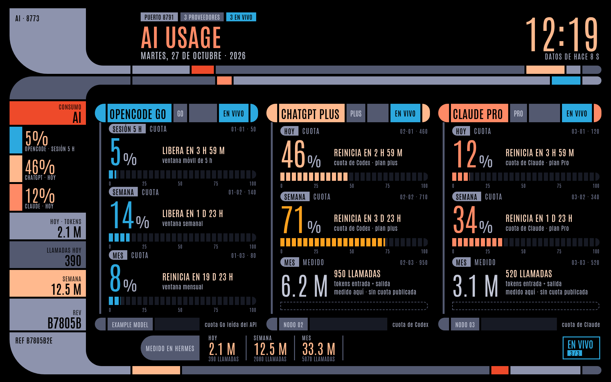

# AI Usage Monitor

Tablero de cuotas de las suscripciones de modelos de IA, pensado para una **tablet
vieja en kiosco** (referencia: Nexus 7 2013 con Android 6.0.1). Lienzo fijo
**1920x1200** (16:10) escalado a la pantalla, tema oscuro, **sin dependencias y sin
build**: Python estándar en el servidor y HTML/CSS/JS a mano en el cliente.



```
python3 server.py                 # http://0.0.0.0:8773/
python3 server.py --once          # imprime el JSON y sale
python3 server.py --offline       # sin tocar red (solo medido + manual)
python3 server.py --mock          # datos de ejemplo
./scripts/install-user-service.sh # servicio de usuario + verificación
python3 -m unittest discover -s tests
```

## Qué muestra

Una tarjeta por suscripción, con tres huecos cada una: **sesión / semana / mes**.
Cada hueco es una de dos cosas, y se ve distinto a propósito:

- **Gauge** (anillo con %): el proveedor **publica** esa cuota y la leemos.
- **Número en anillo punteado**: el proveedor no publica cuota de ese periodo; se
  muestra el **uso medido aquí** (tokens de entrada + salida) y el número de
  llamadas. Nunca un porcentaje inventado.

El pie de cada tarjeta dice de dónde salió el dato (`EN VIVO`, `MEDIDO`, `MANUAL`,
`SIN DATOS`, `CUOTA EN PAUSA`) y la nota del servidor dice la causa cuando algo
falla.

| Proveedor | Ventanas con cuota | Fuente real |
|---|---|---|
| OpenCode Go | rolling 5 h, semana, mes | **vivo**: `GET opencode.ai/zen/go/v1/usage` con `OPENCODE_GO_API_KEY` |
| ChatGPT Plus | 5 h y semana (Codex) | **vivo**: `GET chatgpt.com/backend-api/wham/usage` con el OAuth de `~/.codex/auth.json` |
| Claude Pro | 5 h y semana | **vivo**: `GET api.anthropic.com/api/oauth/usage` con el OAuth de `~/.claude/.credentials.json` |
| ~~Gemini Pro~~ | — | **deshabilitado** (`enabled: false`): Google cerró el cliente OAuth de Code Assist para cuentas individuales (2026-10, pide migrar a Antigravity). El adaptador sigue en el código por si vuelve a existir una fuente |

Con tres tarjetas el tablero va a **una columna por proveedor**, con los tres
anillos apilados; el `grid` se adapta al número de tarjetas (`data-n`).

## Credenciales que usa

No hay login propio: cada adaptador lee el token que dejó el CLI dueño de la
cuenta y lo refresca si está por vencer (reescribe el archivo con `chmod 600`).

| Proveedor | Archivo / variable |
|---|---|
| OpenCode Go | `OPENCODE_GO_API_KEY` en `~/.hermes/.env` |
| ChatGPT Plus | `~/.codex/auth.json` (`codex login`) |
| Claude Pro | `~/.claude/.credentials.json` (`claude auth login --claudeai`) |

Ninguna de esas credenciales vive en este repo ni se imprime en la salida.

## Uso manual (cuando no hay credencial viva)

```bash
./usage-set.py set claude session 42 --reset 2026-10-23T03:00
./usage-set.py set claude week 68
./usage-set.py list
```

También por HTTP, útil desde el teléfono:

```bash
curl -X POST http://localhost:8773/api/manual \
  -H 'Content-Type: application/json' \
  -d '{"provider":"claude","window":"session","pct":37}'
```

`manual.json` es local (no se versiona) y la tarjeta lo marca `MANUAL`: un dato
capturado a mano nunca se disfraza de vivo.

## Detalles que importan

- **Cuota de Go**: se lee del API (`/zen/go/v1/usage`), no se calcula. El 403 de
  Cloudflare (*error 1010, browser_signature_banned*) aparece si la petición viaja
  con el User-Agent de Python-urllib; por eso `OPENCODE_UA` va explícito.
- **Si el API de cuota falla**, la tarjeta pasa a `MEDIDO`: muestra los tokens en
  anillos punteados, con la causa en la nota. El cálculo por tokens × precio de
  lista se desfasa de lo que cobra el proveedor, así que nunca se pinta como cuota.
- **Ventanas de Go**: el API manda `rolling`, `weekly` y `monthly` con `percent` y
  `resetsAt`. `rolling` es la ventana móvil de 5 h.
- **Ventanas móviles**: el "libera en …" es cuándo **empieza a salir** el consumo
  más viejo de la ventana; no es un reinicio en seco.
- **Cache negativo**: una credencial muerta o un endpoint limitado no se reintenta
  cada minuto; la tarjeta dice la causa y se espacia el intento.
- **HTTP 429 no es sesión cerrada**: Anthropic limita su endpoint de uso y responde
  429 con el OAuth perfectamente válido. La tarjeta lo dice (`CUOTA EN PAUSA`) en
  vez de pedir un login que no hace falta.
- **Recarga sin tocar la tablet**: `/api/data` publica `version` (hash de `web/`);
  si cambia, la página se recarga sola.
- **Errores honestos**: cada fuente falla sola y su causa se pinta en la tarjeta.

## Kiosco en la tablet

- Pantalla **1920x1200** (16:10). El lienzo es exactamente ese tamaño: en la
  tablet, 1 px de diseño = 1 px físico (escala 0.5 CSS con DPR 2).
- **Que no se apague**: `Opciones de desarrollador → Permanecer despierto` (con el
  cargador puesto) y `Pantalla → Suspender` al máximo; Android 6 no tiene "Nunca".
  Además, Daydream desactivado y, si se usa Fully Kiosk, *Device Manager →
  Keep Screen On* con *Screen Off Timer = 0*. El wake lock del navegador no es
  confiable en WebView viejo.
- **Fully Kiosk Browser 1.49.1** es la última versión que soporta Android 6 (las
  actuales piden 7+). Alternativa sin instalar nada: *Fijar pantalla* de Android 6
  con Chrome.
- **CSS conservador, a propósito**: el WebView puede ser mucho más viejo que el de
  la máquina de desarrollo. Nada de `inset` (Chromium < 87 lo ignora y el bloque
  absoluto se sale del anillo), `:has()`, `dvh`, `color-mix()` ni container
  queries. Se usan offsets explícitos, grid/flex, variables CSS y SVG.
- El servidor anota el `User-Agent` del kiosco en el journal la primera vez que
  abre la página: así se sabe qué motor trae la tablet antes de tocar el CSS.

## Qué queda fuera del repo

- `manual.json` — porcentajes capturados a mano (datos de la cuenta).
- `screenshots/` — capturas con uso real; en el repo va `docs/demo.png`,
  regenerado con `--mock`.
- Credenciales de cualquier tipo: las lee el servidor de tu propio home, nunca se
  commitean.
- `config.json` sí se publica: solo trae nombres, planes y colores.

## Licencia

MIT — ver [LICENSE](LICENSE).
